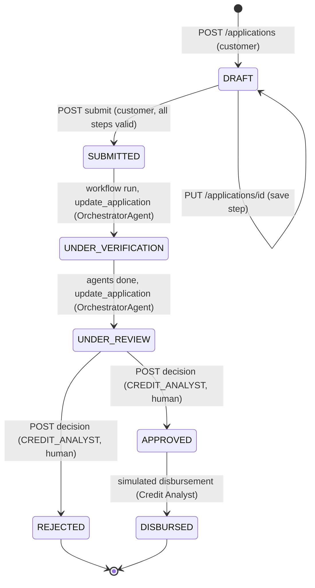

# Flow — LoanLens AI

Runtime paths: frontend routes and components, backend call chains per endpoint, the orchestrator step by step, the application state machine, and the startup sequence. Names match `Architecture.md` §3, `Integration_Contracts.md` §6, `Design.md` and `openapi.yaml`.

**Status: design only. No code exists yet; everything below is planned.**

## 1. Frontend routes per role

`src/routes/index.tsx` (`createBrowserRouter`). `RoleGuard` wraps every protected route with an `allow={[...]}` list: no token → `/login`; wrong role → `ForbiddenPage` (403 view used in the demo). `landingFor(role)`: `CUSTOMER → /products`, `LOAN_OFFICER → /officer/queue`, `CREDIT_ANALYST → /officer/queue`.

| Route | Page | Roles | Hooks (one per endpoint, `src/api/*.ts`) |
|---|---|---|---|
| `/login` | `LoginPage` | public | `useLogin` |
| `/` | redirect via `landingFor` | any | `useMe` |
| `/products` | `CataloguePage` | any | `useProducts(filters)` |
| `/compare?ids=a,b` | `ComparePage` | any | `useCompareProducts(ids)` |
| `/products/:productId` | `ProductDetailPage` | any | `useProduct(id)`, `useEmi()` |
| `/emi` | `EmiCalculatorPage` | any | `useEmi()` |
| `/advisor` | `AdvisorPage` | logged in | `useAdvisorChat()` |
| `/policy` | `PolicyPage` | logged in | `usePolicyAsk()` |
| `/profile` | `ProfilePage` | CUSTOMER | `useProfile()`, `useUpdateProfile()` |
| `/applications` | `MyApplicationsPage` | CUSTOMER | `useApplications()` |
| `/applications/new` | `ApplicationWizardPage` | CUSTOMER | `useCreateDraft()` → navigate to `/applications/:id` |
| `/applications/:applicationId` | `ApplicationWizardPage` | CUSTOMER (owner) | `useApplication(id)`, `useSaveDraft(id)`, `useSubmitApplication(id)`, `useDocuments(id)`, `useUploadDocument(id)`, `useProducts()`, `useEmi()` |
| `/applications/:applicationId/status` | `ApplicationStatusPage` | CUSTOMER (owner), staff | `useApplication(id)`, `useRecommendation(id)` |
| `/officer/queue` | `OfficerQueuePage` | LOAN_OFFICER, CREDIT_ANALYST | `useApplications({status})`, `useRunWorkflow(id)` |
| `/knowledge` | `KnowledgePage` | LOAN_OFFICER, CREDIT_ANALYST | `useKnowledgeDocuments()`, `useUploadKnowledge()` |
| `/analyst/review/:applicationId` | `AnalystReviewPage` | LOAN_OFFICER (read + run), CREDIT_ANALYST (run + decide) | `useApplication(id)`, `useDocuments(id)`, `useRunWorkflow(id)`, `useRecommendation(id)`, `useAuditTrail(auditTrailId)`, `useDecision(id)` (analyst only) |
| `*` | `NotFoundPage` | any | — |

Role-based navigation (M1-8), `Nav.tsx → navItemsFor(role)`: Customer — Products, EMI calculator, Advisor, Policy assistant, My applications, Profile. Loan Officer — Queue, Policy assistant, Knowledge base, Products. Credit Analyst — Review queue, Policy assistant, Knowledge base, Products. The backend enforces the same matrix with `requireRole(...)`; the UI only hides.

## 2. Component tree

```
App
└─ QueryClientProvider → RouterProvider
   └─ AppLayout                               src/components/layout/AppLayout.tsx
      ├─ Nav (navItemsFor(role), RoleBadge + name, theme toggle, Logout)
      └─ <Outlet/> → page
         ├─ LoginPage ─ login form
         ├─ CataloguePage ─ ProductFilters (q, loanType, segment, amount range, sort) ─ ProductCard ×N (compare checkbox, max 4)
         ├─ ComparePage ─ CompareTable (2–4 columns, "Best" per row)
         ├─ ProductDetailPage ─ ProductCard (full) ─ EmiCalculator (prefilled) ─ EmiTable
         ├─ EmiCalculatorPage ─ EmiCalculator ─ EmiTable
         ├─ AdvisorPage ─ ChatPanel ─ RecommendationCard ×N (or clarifyingQuestion bubble) + disclaimer
         ├─ PolicyPage ─ ChatPanel (loanType / segment selects) ─ SourceChip ×N + ConfidenceBadge
         ├─ ProfilePage ─ profile form (employmentType, segment, income, obligations, location; kycStatus read-only)
         ├─ MyApplicationsPage ─ application list (status chip, links to edit / status)
         ├─ ApplicationWizardPage ─ FormStepper (Save draft, Next/Back, Submit)
         │     ├─ steps/ProductAmountStep (product, amount, tenure, purpose; estimatedEmi from useEmi)
         │     ├─ steps/EmploymentStep (employmentType, income, obligations; prefilled from profile)
         │     ├─ steps/DocumentsStep ─ FileDropzone ×3 (IDENTITY, ADDRESS, INCOME; ≤ 5 MB pdf/jpg/png)
         │     └─ steps/ReviewStep
         ├─ ApplicationStatusPage ─ StatusTimeline (status_event list) ─ customerMessage + missingDocuments if present
         ├─ OfficerQueuePage ─ queue table (status filter, link to review)
         ├─ KnowledgePage ─ KnowledgeUploadForm (file + metadata) ─ KnowledgeTable (isLatest badge)
         ├─ AnalystReviewPage ─ application summary ─ document list ─ "Run agents" button
         │     ├─ AgentChecksTable (recommendation pill, riskBand, agent · result · detail, missingDocuments, customerMessage)
         │     ├─ AuditTrailViewer (sequence · time · agent · eventType · tool · duration; expandable masked JSON; PERMISSION_DENIED filter)
         │     └─ DecisionForm (APPROVED / REJECTED + reason ≥ 10 chars; analyst only, enabled only in UNDER_REVIEW)
         ├─ ForbiddenPage
         └─ NotFoundPage
```

`src/api/client.ts` is the single `fetch` wrapper: adds `Authorization: Bearer`, base URL from `VITE_API_BASE_URL`, parses the error envelope into `ApiError {status, code, message, details}`, and on `401` clears the token and routes to `/login`. Every hook in `src/api/*.ts` is a TanStack Query `useQuery` / `useMutation` over one endpoint with a stable key (`['products', filters]`, `['application', id]`, …); mutations invalidate what they change (`useSubmitApplication` → `['application', id]`, `['applications']`). Money is formatted by `utils/money.ts → formatInr`; the browser never computes EMI. With `VITE_USE_MOCKS=true`, `src/mocks/handlers.ts` (MSW) answers every endpoint with the `openapi.yaml` examples.

## 3. Backend call chains per endpoint

Pattern everywhere: `router.ts` (Zod parse, `requireAuth` / `requireRole`, HTTP only) → `service.ts` (business rules) → `prisma.*` / `generateObject` / `retriever` / tools. Routers contain no business logic.

| Endpoint | Chain |
|---|---|
| `POST /api/auth/login` | `core/auth/router.ts` (`LoginSchema.parse`) → `service.ts login()` → `prisma.appUser.findUnique` → password check → `common/auth.ts signToken({username, role, customerId})` |
| `GET /api/auth/me` | `core/auth/router.ts` → `requireAuth` → `req.user` |
| `GET /api/products` | `core/product/router.ts` (`ProductQuerySchema.parse`) → `service.ts searchProducts(q, loanType, segment, minAmount, maxAmount, sort)` → `prisma.loanProduct.findMany({ where, orderBy })` |
| `GET /api/products/{id}` | `core/product/router.ts` → `service.ts getProduct(id)` → `null` → `AppError(404, 'NOT_FOUND')` |
| `GET /api/products/compare` | `core/product/router.ts` (2–4 ids) → `service.ts compareProducts(ids)` → `prisma.loanProduct.findMany({ where: { productId: { in } } })` → reorder to request order |
| `POST /api/emi/calculate` | `core/emi/router.ts` (`EmiRequestSchema.parse`) → `loanMath.ts calculateEmi()` + `amortization()` → `EmiResult` (no service layer: pure functions) |
| `GET/PUT /api/customers/me` | `core/customer/router.ts` → `requireRole('CUSTOMER')` → `service.ts getCustomer(user.customerId)` / `updateCustomer()` → `prisma.customer` |
| `GET /api/applications` | `core/application/router.ts` → `service.ts listApplications(user, status)`: CUSTOMER → `where: { customerId }`; staff → all (+ status filter) |
| `POST /api/applications` | `core/application/router.ts` (`DraftSchema.parse`) → `service.ts createDraft(customerId, draft)` → `newId('LA')` → `prisma.$transaction([create application, create status_event(DRAFT)])` |
| `PUT /api/applications/{id}` | `core/application/router.ts` → `service.ts saveDraft()` → owner check, `status === DRAFT` else `AppError(409, 'INVALID_STATE')` → merge fields → if product + amount + tenure present, `estimatedEmi = calculateEmi(amount, product.minInterestRate, tenure)` |
| `POST /api/applications/{id}/submit` | `core/application/router.ts` → `service.ts submit()` → `SubmitSchema.parse(application)` (all steps, `400 VALIDATION_FAILED` with `details[]`) → `transition(id, 'SUBMITTED', username, note)` |
| `POST /api/applications/{id}/decision` | `core/application/router.ts` → `requireRole('CREDIT_ANALYST')` → `DecisionSchema.parse` → `service.ts decide()` → `stateMachine.ts assertTransition(UNDER_REVIEW → APPROVED|REJECTED)` → `status_event(by = username, note = reason)` |
| `GET/POST /api/applications/{id}/documents` | `core/document/router.ts` → multer (pdf/jpg/png, ≤ 5 MB, random name) → `service.ts uploadDocument()` → owner + status in (DRAFT, SUBMITTED, UNDER_VERIFICATION, UNDER_REVIEW) → `newId('DOC')` → `prisma.applicationDocument.create` |
| `POST /api/advisor/chat` | `ai/advisor/router.ts` → `advisorService.ts advisorChat()` → `maskPii` → `listProducts()` → `generateObject({ schema: AdvisorExtractionSchema })` → product selection + `calculateEmi` / `obligationRatioPct` → `AdvisorResponseSchema.parse` |
| `GET /api/knowledge/documents` | `ai/rag/router.ts` → `requireRole('LOAN_OFFICER','CREDIT_ANALYST')` → `prisma.kbDocument.findMany({ orderBy: [{title}, {effectiveDate: 'desc'}] })` |
| `POST /api/knowledge/documents` | `ai/rag/router.ts` → multer + `KnowledgeMetaSchema.parse` → `ingest.ts ingestDocument(file, meta)` → parse → `chunker.ts` → `maskPii` → `embeddings.ts embedDocuments()` (Gemini API) → `$executeRaw` insert `kb_chunk` → `prisma.kbDocument.create` → `recomputeLatest(title)` |
| `POST /api/policy/ask` | `ai/rag/router.ts` (`AskSchema.parse`, audience from role) → `policyAssistant.ts askPolicy()` → `maskPii` → `retriever.ts retrieve()` (`embed` + `$queryRaw` with `<=>` and metadata filter) → `generateObject({ schema: GroundedAnswerSchema })` → `PolicyAnswerSchema.parse` |
| `POST /api/workflow/applications/{id}/run` | `ai/agents/router.ts` → `requireRole('LOAN_OFFICER','CREDIT_ANALYST')` → `orchestrator.ts runWorkflow()` → see §4 |
| `GET /api/workflow/applications/{id}/recommendation` | `ai/agents/router.ts` → `prisma.agentRun.findFirst({ where: { applicationId }, orderBy: { startedAt: 'desc' } })` → `recommendation_json` |
| `GET /api/audit/{auditTrailId}` | `ai/audit/router.ts` → `requireRole('LOAN_OFFICER','CREDIT_ANALYST')` → `auditService.ts getTrail()` → `prisma.auditEvent.findMany({ orderBy: { sequence: 'asc' } })` |

Cross-cutting middleware order in `app.ts createApp()`: `cors(allow-list)` → `express.json()` → `pino-http` (masked) → routers (each applies `requireAuth` / `requireRole` itself) → `notFound` → `errorHandler`. Async handlers are wrapped so a rejected promise reaches `errorHandler`, which maps `ZodError` → 400 `VALIDATION_FAILED`, bad/missing JWT → 401, `requireRole` miss → 403, `AppError` → its own status/code, AI SDK errors → 503 `AI_UNAVAILABLE`, anything else → 500 `INTERNAL`, all in the §3 envelope.

## 4. Orchestrator execution path (step by step)

`ai/agents/orchestrator.ts → runWorkflow(applicationId, user)`:

1. **Load and gate.** `getApplication(id)`; if `status !== 'SUBMITTED'` → `AppError(409, 'INVALID_STATE')`. Build `AgentContext = { application, customer: getCustomer(), documents: listDocuments(), product: getProduct(), audit }`. Protected attributes are not in the schema, so they cannot enter the context (G-1).
2. **Open audit.** `auditService.start(applicationId)` → `auditTrailId = newId('AUD')`; `agent_run` row inserted with `started_at`.
3. **OrchestratorAgent: move to verification.** `guardedTools('OrchestratorAgent').update_application.execute({ applicationId, status: 'UNDER_VERIFICATION', note: 'Agent workflow started' })` → `transition()`. Audit: `TOOL_CALL`, `TOOL_RESULT`.
4. **`runDocumentVerificationAgent(ctx)`** → `AgentCheck`.
   - Code: `missing = {IDENTITY, ADDRESS, INCOME} − uploaded types` → labels (`"Address proof"`).
   - `generateText({ tools: guardedTools('DocumentVerificationAgent') })`; the model calls `verify_income(customerId, declaredIncome)` (code calls it if the model did not). Mismatch if `|declared − verified| / verified > 20 %`; name/address mismatch flags come from the mock per seeded customer.
   - Result (code): `INCOMPLETE` if anything missing, else `FAIL` if any mismatch, else `PASS`. The model's text becomes `detail`; template fallback (`"Address proof is missing"`) if the LLM is unavailable. The LLM cannot change `result`.
   - Audit: `AGENT_START`, `LLM_CALL`, `TOOL_CALL`, `TOOL_RESULT`, `LLM_RESULT`, `AGENT_END`.
5. **`runCreditAssessmentAgent(ctx)`.**
   - Tools `get_credit_score(customerId)` → `{score, band}` and `verify_income` for the income used in the ratio.
   - `emi = calculateEmi(requestedAmount, product.minInterestRate, tenureMonths)`; `ratio = obligationRatioPct(income, existingObligations, emi)`.
   - `PASS` if `ratio ≤ product.maxObligationRatioPercent` and `score ≥ product.minCreditScore`, else `FAIL`. `detail` worded by the LLM from `{ratio, limit, band}` ("Obligation ratio is 38% (limit 50%); credit score band is 720-760").
6. **`runComplianceAgent(ctx)`.**
   - Tools `get_kyc_status(customerId)` and `search_policy(question, filters)`, which calls `askPolicy(..., audience = ALL)` with the product's `loanType` and a question built from amount, tenure and segment ("Are there policy exceptions for a PERSONAL loan of 500000 over 36 months for a SALARIED customer?").
   - `PASS` if KYC `VERIFIED` and the grounded answer reports no exception; `INCOMPLETE` if `PENDING`; `FAIL` if `FAILED` or an exception is found (`policyException = true` passed to the orchestrator).
7. **Orchestrator decision (code only).** `checks = [DV, CA, CO]`.
   - `recommendation`: any `INCOMPLETE` → `REQUEST_ADDITIONAL_DOCUMENTS`; else any `FAIL` → `RECOMMEND_REJECT`; else any `EXCEPTION` → `REFER_TO_HUMAN`; else `RECOMMEND_APPROVE`.
   - `riskBand`: `HIGH` if `score < 680` or `ratio > 45`; `LOW` if `score ≥ 750` and `ratio < 35`; else `MEDIUM`.
   - `requiresHumanApproval`: the `Integration_Contracts.md` §7 rule (any check ≠ PASS, amount ≥ 10,00,000, ratio 45–55 %, score 640–680, policy exception) OR-ed with `true` — always true in this build. The computed reason is written as a `HUMAN_REQUIRED` audit event.
8. **`runCustomerCommunicationAgent(ctx, checks, recommendation)`** → `customerMessage`. The LLM gets the recommendation, missing-document labels and amounts and writes one or two plain sentences with no new numbers; template fallback per recommendation. Not added to `checks[]` (the brief shows three checks); its LLM call is audited under `agent = CustomerCommunicationAgent`.
9. **OrchestratorAgent: move to review.** `update_application(id, 'UNDER_REVIEW', '<recommendation>: <summary>')` through the guard. The tool refuses any target other than `UNDER_VERIFICATION` / `UNDER_REVIEW` (G-2).
10. **Persist and return.** `agent_run` updated with `recommendation`, `risk_band`, `recommendation_json`, `completed_at`; `auditService.complete()`; return `AgentRecommendationSchema.parse({ applicationId, recommendation, riskBand, checks, missingDocuments, customerMessage, requiresHumanApproval, auditTrailId })`.

**Permission violation** (any step): the wrapped `execute` sees `(agent, tool)` outside the allow-list → throws `AgentPermissionDeniedError` → audit `PERMISSION_DENIED {agent, tool}` → that agent's check becomes `EXCEPTION` with `detail "Refused: <Agent> is not permitted to call <tool>"` → the run continues to step 7 (which yields `REFER_TO_HUMAN` unless an `INCOMPLETE` wins). Demo trigger: staff-only `?demoPermissionViolation=true` on the run endpoint makes CustomerCommunicationAgent attempt `get_credit_score` (planned); `permissionGuard.test.ts` covers the same path.

**Brief scenario** (seeded `LA-2026-00418`, CUST-1001, ₹5 lakh personal loan, IDENTITY + INCOME uploaded, no ADDRESS): DV → `INCOMPLETE` "Address proof is missing"; CA → `PASS` (mock score 735 / band 720-760; seed values chosen so code computes 38 % against a 50 % limit, e.g. income 60,000, obligations 6,500, 11 % over 36 months → EMI 16,369 → 38 %); CO → `PASS` "KYC status verified"; result `REQUEST_ADDITIONAL_DOCUMENTS`, `riskBand MEDIUM`, `missingDocuments ["Address proof"]`, `requiresHumanApproval true`. Covered by `orchestrator.test.ts` with the LLM mocked (`vi.mock`).

## 5. Application state machine



`core/application/stateMachine.ts → assertTransition(from, to)` holds the allowed-edge set; any other edge → `AppError(409, 'INVALID_STATE')`. Every transition goes through `service.ts → transition()` and appends a `status_event {status, at, by, note}` in the same Prisma transaction; that list is the `timeline` in `LoanApplication` and in `StatusTimeline`. Uploads are allowed in `DRAFT`, `SUBMITTED`, `UNDER_VERIFICATION`, `UNDER_REVIEW` so a customer can answer `REQUEST_ADDITIONAL_DOCUMENTS`. A workflow run needs `SUBMITTED`, so there is no agent re-run after review in this build; the seed provides a second submitted application for a fresh run in the demo (log in `docs/ASSUMPTIONS.md`). Covered by `stateMachine.test.ts`.

## 6. Startup sequence

```mermaid
sequenceDiagram
    autonumber
    participant Dev
    participant DC as docker compose
    participant PG as Postgres (pgvector/pgvector:pg16)
    participant PR as Prisma CLI
    participant SD as prisma/seed.ts
    participant IN as ai/rag/ingest.ts
    participant EM as Gemini embeddings API
    participant BE as Express (tsx watch)
    participant FE as Vite dev server

    Dev->>DC: docker compose up -d
    DC->>PG: start, healthcheck pg_isready
    Dev->>PR: cd backend, npm i, npx prisma migrate dev
    PR->>PG: apply migrations (CREATE EXTENSION vector, core tables, kb tables with vector(768) + HNSW, agent and audit tables)
    Dev->>SD: npm run seed
    SD->>PG: upsert 5 users, 3 customers, 8 products, 2 applications + documents + status events (idempotent)
    Dev->>IN: npm run ingest
    loop each file in db/knowledge/manifest.json not yet in kb_document (title + version)
        IN->>EM: embedMany(masked chunks, RETRIEVAL_DOCUMENT, 768 dims, batches of ≤ 100; 429 → wait 2 s, retry once)
        IN->>PG: insert normalised vectors into kb_chunk, recompute is_latest
    end
    Dev->>BE: npm run dev
    BE->>BE: env.ts parses process.env (fail fast), createApp(), listen :8080
    Dev->>FE: cd frontend, npm i, npm run dev
    FE-->>Dev: http://localhost:5173 (VITE_USE_MOCKS=false uses the real API)
```

One line: `docker compose up -d && cd backend && npm i && npx prisma migrate dev && npm run seed && npm run ingest && npm run dev`, then `cd frontend && npm i && npm run dev`. Order of dependence: Postgres must be healthy before migrate/seed/ingest; ingest needs the migrated tables; the frontend needs only the backend URL. Re-running is safe: migrations are versioned, the seed upserts, ingest skips documents already present. `docker compose down -v` resets everything. `npm run ingest` and every policy question call the Gemini embeddings API, so they need internet and `LL_EMBED_API_KEY`; if the API fails at query time the backend returns `AI_UNAVAILABLE` 503 instead of answering without retrieval.
