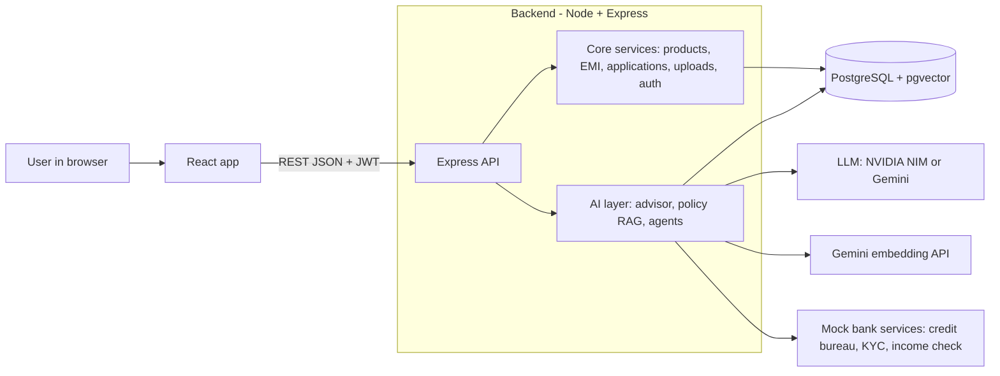
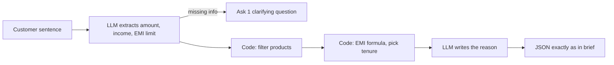
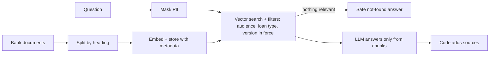
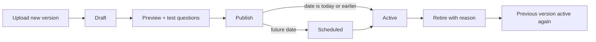
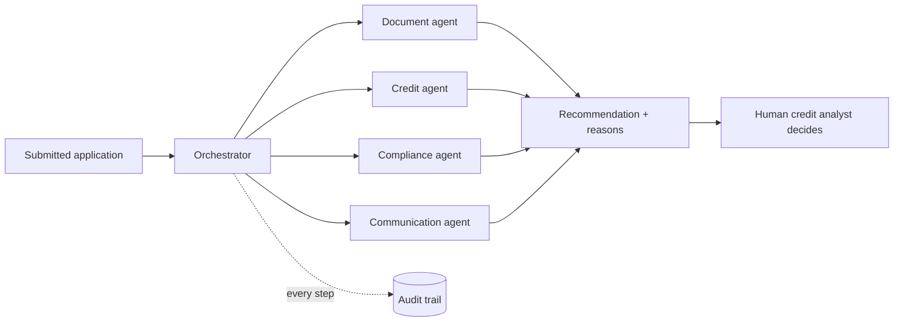

# LoanLens AI — Preliminary Design

> **Read this first.** New to the project? Read in this order:
> 1. This file — what we are building and why
> 2. `Getting_Started.md` — laptop setup, branches, the git loop
> 3. `docs/USECASE.md` — the official hackathon brief
> 4. `Team_Work_Split.md` — who owns what
> 5. `prompts/S1_backend_core.md`, `S2_backend_ai.md` or `S3_frontend.md` — your build spec
>
> Status: **design stage.** Nothing below is built yet. Everything describes what we plan to build.

---

## 1. The problem

Kestrel Bank is a retail bank with 12 million customers. It sells personal, home, vehicle and education loans.

**Customers struggle.** They don't know which loan fits them, whether they are eligible, or what the fees are. They submit the same documents again and again. They can't see where their application stands. The branch, call centre and app give different answers.

**Bank staff struggle.** They check documents by hand. They apply credit policy inconsistently across thousands of applications. Many applications are incomplete. They find it hard to explain a rejection. Regulators require a full audit trail.

## 2. Our solution in one paragraph

LoanLens AI is a web app with three AI features on top of a normal lending portal:

- **Advisor.** An AI loan advisor turns a sentence like *"I need ₹5 lakh for a used car, I earn ₹60,000, EMI under ₹12,000"* into concrete product suggestions with real EMI numbers.
- **Policy assistant.** It answers questions **only** from the bank's approved documents and shows the exact source.
- **Pre-screening agents.** A team of AI agents pre-checks every application: documents, affordability and compliance. They hand a clear recommendation to a human credit analyst, who makes the final decision. Every step is logged.

---

## 3. AI words we use, in plain English

| Term | Meaning |
|---|---|
| **LLM** | Large Language Model. The AI that reads and writes text. We use Llama 3.1 70B via NVIDIA, or Gemini as backup. |
| **Embedding** | A list of 768 numbers that captures the meaning of a piece of text. Texts with similar meaning get similar numbers. We get them from Gemini's embedding API. |
| **Vector search** | Finding the stored texts whose embeddings are closest to the question's embedding. In practice, "find the paragraphs most related to this question". |
| **Chunk** | A small piece of a document, usually one section under a heading. We search chunks, not whole documents. |
| **RAG** | Retrieval-Augmented Generation. First *retrieve* the relevant chunks, then let the LLM *generate* an answer **only** from them. This stops the AI from making things up. |
| **Structured output** | Forcing the LLM to reply in an exact JSON shape that we define, instead of free text. |
| **Agent** | An AI worker with one specific job and a fixed set of tools it is allowed to use. |
| **Tool calling** | An agent asking our code to do something, such as "get this customer's credit score". The code runs it and returns the result. |
| **Human-in-the-loop (HITL)** | The AI only recommends. A human always makes the final decision. |
| **Guardrail** | A hard rule the system enforces in code, such as "never use gender in a decision". |

---

## 4. Tech stack

| Layer | Technology | What it does | Why we picked it |
|---|---|---|---|
| Frontend | **React 19 + Vite + TypeScript** | The web UI | Our team's strongest skill. Vite starts in under a second. |
| Styling | **Tailwind CSS v4** | Utility CSS classes | Brand colours live in one CSS block (`@theme`), so a judge's "change the colour" request is a one-line edit. |
| Data fetching | **TanStack Query** | Calls the API, caches results, handles loading and error states | Removes boilerplate. |
| Mock API | **MSW** (Mock Service Worker) | Fake API responses in the browser | The frontend never waits for the backend. |
| Backend | **Node 22 + Express + TypeScript** | The REST API | Our team has shipped Express apps before. |
| Validation | **Zod** | Checks every request | One schema gives validation, types and the LLM's output format. |
| Database | **PostgreSQL 16 + pgvector** | Stores all data and the embeddings | The brief recommends it. One database handles both normal and vector data. |
| ORM | **Prisma** | Talks to Postgres from TypeScript | Typed queries and easy migrations. We used it in a past project. |
| AI SDK | **Vercel AI SDK** | Calls the LLM; structured output and tool calling | One interface for both NVIDIA and Gemini. |
| LLM | **NVIDIA NIM (Llama 3.1 70B)**, Gemini 2.0 Flash as backup | Understands language and writes answers | Both are free. Switching takes 3 lines in `.env`. |
| Embeddings | **Gemini `gemini-embedding-001`** via API (768 dims) | Turns text into 768 numbers for search | Free with our Gemini key. No model to host, so the backend stays small and deploys anywhere as a web app. |
| Auth | **JWT** with 4 roles | Login and permissions | Customer, Loan Officer and Credit Analyst, as the brief requires, plus a Policy Admin who owns the policy documents. |
| Infra | **Docker Compose** | Runs Postgres with one command | Same setup on all three laptops. |
| Tests | **Vitest + Supertest** | Unit and API tests | Fast, and TypeScript-native. |

---

## 5. System at a glance

**How to say it:** "The React app talks to one Express API. Half of the API is normal banking logic. The other half is the AI layer, which uses the LLM for language and Gemini's embedding API for search. Everything is stored in one Postgres database that also does vector search."

---

## 6. How each module works

### Module 1: Loan discovery, application and AI Advisor

**The normal portal.** It has a product catalogue with search, filters, sort and compare. It has an EMI calculator with a month-by-month schedule. Customers get a profile and a 4-step application form that saves drafts. They upload identity, address and income documents and track their application on a status timeline. Each role sees different menus.

**The AI Advisor, step by step:**
1. The customer types: *"I need ₹5 lakh for a used car. I earn ₹60,000 per month and want an EMI below ₹12,000."*
2. **The LLM extracts facts** into a fixed JSON shape: amount 500000, income 60000, max EMI 12000, purpose "used car".
3. If something important is missing, such as the amount, it returns **one clarifying question** and stops.
4. **Our code, not the AI,** picks the matching products. It tries tenures and computes the EMI with the standard formula, then finds the shortest tenure that keeps the EMI under ₹12,000.
5. Code decides eligibility from the income-to-obligation ratio.
6. **The LLM only writes the explanation sentence** from those numbers.
7. Result: **Kestrel Pre-Owned Car Loan (VL-204), 11 %, 60 months, EMI ₹10,871, "about 18 % of income", LIKELY_ELIGIBLE.** This matches the brief exactly.

**Key point for judges:** the AI never does maths. EMI is `P × r × (1+r)^n / ((1+r)^n − 1)`, computed in `core/emi/loanMath.ts`.

### Module 2: RAG policy assistant

**Setting up the knowledge (once):**
1. We wrote about 10 synthetic bank documents: loan terms, fees, credit policy, KYC checklist, foreclosure rules, grievance process, regulatory summary, and an **internal** officer playbook.
2. Each document has metadata: version, effective date, loan type, document type, audience (customer or internal) and customer segment.
3. We **split each document by its headings**, so each chunk is one meaningful section.
4. Each chunk is turned into an **embedding** and stored in Postgres with its metadata.

**Answering a question:**
1. A question such as *"Can I foreclose my vehicle loan after six months?"* is first **masked**: PAN, Aadhaar and account numbers are hidden.
2. The question is embedded and we **search for the closest chunks**, with filters:
   - **Audience.** Customers can never see internal documents.
   - **Loan type and segment.**
   - **Version in force only.** If several versions exist, we use the published one with the latest effective date that is not in the future (see "Policy updates and version control" below).
3. If no chunk is close enough, we return a **safe "not found" answer** without calling the AI.
4. Otherwise the LLM answers **only from those chunks** and tells us which ones it used.
5. **Our code attaches the sources** (document, section, version, date). The AI can't invent a source.
6. Result: *"Foreclosure is allowed after 6 EMIs, with a 2 % charge on the outstanding principal."* Source: Vehicle Loan Terms, v2026.3, effective 2026-07-01.

**The demo trick:** the vehicle-loan document exists in two versions. The old one says 12 EMIs at 4 %; the new one says 6 EMIs at 2 %. The assistant always quotes the new one.

### Policy updates and version control (Policy Admin)

A judge asked: *"How does the chatbot get updated policies, and how do you control versions?"* Our answer is a new role, the **Policy Admin**. This is a bank official (demo user `admin.rao`) and the only person allowed to change policy documents.

**The rules, in plain English:**
1. **Never overwrite.** Every upload is a new version of a policy, for example Vehicle T&C `VEHICLE-TNC` v2026.4. Old versions stay, so we always have history and can roll back.
2. **Draft first.** A new version starts as a **draft**. Nobody else sees it. The admin **previews** how it was split into sections and **asks it test questions** before going live.
3. **Publish.** Publishing makes the version official. After that it can't be edited; a fix means a new version.
4. **Which version answers?** For each policy, the chatbot uses the **published version with the latest effective date that is today or earlier**. We work this out every time a question is asked. So a version dated next month is **scheduled** and goes live on that date by itself, with no timer job.
5. **Retire = undo.** If a published version is wrong, the admin retires it with a reason. The previous version is answering again immediately.
6. **Everything is logged.** Each draft, publish and retire writes an audit event (`POLICY_DRAFTED`, `POLICY_PUBLISHED`, `POLICY_RETIRED`) with who did it, when, and the change note or reason.
7. **Customers stay safe.** They never see drafts, retired versions, scheduled versions or internal documents.

**Worked example.** Vehicle T&C v2026.3 is active: "foreclose after 6 EMIs, 2 % charge". The admin uploads v2026.4 with the note "3 EMIs, 1 %", previews it, test-asks it and publishes it. A customer asking the same foreclosure question now gets "3 EMIs, 1 %", citing v2026.4. If the admin then retires v2026.4, the very next answer cites v2026.3 again.

**Why the answer format doesn't change:** answers already show the version and effective date of their source, so the brief's response shape stays exactly the same.

### Module 3: Agentic loan processing

Think of it as a **relay team of specialists**, each allowed to use only certain tools:

| Agent | Job | Tools it may use |
|---|---|---|
| Document Verification | Are identity, address and income proofs present? Do name, income and address match? | income check |
| Credit Assessment | Is the loan affordable? Computes the obligation ratio and checks the credit score band. | credit score, income check |
| Compliance | Is KYC done? Is there a policy exception? | KYC status, policy search (RAG) |
| Customer Communication | Writes a plain-language message to the customer | none |
| Orchestrator | Runs the others in order, combines results, decides that a human must review | update application status |

**Step by step, for the brief's example application LA-2026-00418** (₹5 lakh personal loan, salary slips + bank statement, **no address proof**):
1. A loan officer clicks **"Run AI pre-screen"**.
2. Orchestrator moves the status to *Under Verification* and starts an **audit trail**.
3. Document agent finds address proof missing and returns **INCOMPLETE**.
4. Credit agent gets the mock credit score (742, band 720–760). **Code** computes the obligation ratio and returns **PASS** (ratio well under the 50 % limit).
5. Compliance agent finds KYC verified and returns **PASS**.
6. Communication agent drafts: *"Please upload a valid address proof to continue your application."*
7. Orchestrator applies a **code rule**: anything incomplete means **REQUEST_ADDITIONAL_DOCUMENTS**. It sets `requiresHumanApproval: true` and moves the status to *Under Review*.
8. The credit analyst sees the checks, the reasons and the full audit trail, then **decides**.

**Permission guard:** if an agent tries a tool it isn't allowed, for example the Communication agent asking for a credit score, the call is **refused and logged** as `PERMISSION_DENIED`. For the demo, a staff-only switch makes this happen on purpose so judges can see it.

---

## 7. Why we changed the architecture (from Spring Boot to Node)

The brief **recommends** Java + Spring Boot + Spring AI. It also says teams *"may use any approved AI models, frameworks, libraries"*. We chose Node + Express + TypeScript. Our reasons:

1. **Working software scores; framework choice doesn't.** Judges score what runs. Our team has shipped Node, Express, Prisma, React and JWT apps; none of us has shipped Spring. Learning Spring AI during a hackathon would cost hours we need for the three modules.
2. **We changed the runtime, not the design.** The API contract, Postgres + pgvector, the agents, the audit trail and every guardrail are exactly what a Spring version would have. Every Spring AI concept has a direct equivalent (table below).
3. **One schema to rule them all.** A single Zod schema validates the request, gives TypeScript types, *and* tells the LLM the exact JSON shape to return. The brief's field names can't drift.
4. **One language end to end.** Frontend, backend, agents and tests are all TypeScript, so all three of us can review each other's code.
5. **Faster iteration.** The backend restarts in under a second; a Spring Boot restart takes 5–15 seconds. Over hundreds of edits that adds up to hours.
6. **Free, hosted AI with nothing to run ourselves.** One SDK talks to NVIDIA or Gemini, so switching the chat model is a config change. Search embeddings also come from Gemini's API. No AI model runs on our server, so the backend is a plain lightweight Node app that deploys to any web host, including free tiers. Both keys are free.

| Spring idea | Our equivalent |
|---|---|
| `@RestController` + `@Valid` | Express router + Zod |
| `@ControllerAdvice` | one `errorHandler` middleware |
| Spring Security roles | `requireRole()` middleware |
| JPA + Flyway | Prisma models + migrations |
| Spring AI `ChatClient` | AI SDK `generateText` / `generateObject` |
| `@Tool` | AI SDK `tool()` |
| `BeanOutputConverter` | `generateObject` with a Zod schema |
| `PgVectorStore` | pgvector SQL query via Prisma |

**The honest one-liner:** *"In a bank's Java platform team we'd use Spring AI. The design is framework-neutral and ports mechanically. We picked the stack that let three students ship all three modules, tested."*

**Why Tailwind v4:** the theme is configured in CSS, with no JavaScript config file. Brand tokens live in one place and builds are faster. It's an upgrade over v3.

---

## 8. Guardrails and responsible AI

| Guardrail (from the brief) | How we enforce it |
|---|---|
| Never use gender, religion, caste or marital status | These fields **don't exist** in our database or code. |
| Agents never approve or reject | Agents have no code path to the decision API. Only the Credit Analyst role can call it. |
| Plain-language reason for every recommendation | Every agent check has a required `detail` field. Every advisor suggestion has a `reason`. |
| Out-of-permission actions refused and logged | A permission guard wraps every tool and writes `PERMISSION_DENIED` to the audit trail. |
| Numbers computed by code, not AI | EMI and ratios come only from `loanMath.ts`. |
| Answers only from approved documents | RAG with a relevance threshold. A safe "not found" answer otherwise. Sources are added by code. |
| Mask PAN, Aadhaar and account numbers | One `maskPii()` function runs on every prompt, audit record and log line. |
| Human decides borderline, high-value and exception cases | We go further: a human decides **every** case. |
| Only authorised officials change policy; every change versioned and audited | Only the Policy Admin role can draft, publish or retire a policy. Versions are never overwritten, and each action is logged. |

---

## 9. How we are building it (our process)

1. **Contract first.** Before writing code, we turned the brief's three JSON examples into `openapi.yaml`, a single API contract that everyone builds against.
2. **Three parallel streams, split by layer:**
   - **S1, backend core:** API, database, auth, products, EMI, applications.
   - **S2, backend AI:** RAG, advisor, agents, audit, masking.
   - **S3, frontend:** every screen for all four roles.
   Nobody edits another stream's folders, so there are no merge conflicts.
3. **No waiting.** S3 uses mock API responses, and S2 uses stubs of S1's functions until real code merges.
4. **GitHub workflow.** Each person works on their own branch and opens a pull request when a phase passes its checks. A teammate reviews, then we squash-merge and everyone pulls.
5. **AI-assisted coding with human control.** We use Gemini in Antigravity with detailed specs in `prompts/`. We review every PR, run the tests, and tick a requirement in `REQUIREMENTS.md` only with proof.
6. **Phases.**

| Phase | What happens |
|---|---|
| P0 | Planning docs and contract (done) |
| P1 | Skeletons |
| P2 | Features |
| P3 | Agents and integration |
| P4 | Polish and demo |

---

## 10. Known limitations and what's next

**Limitations:**
- Credit bureau, KYC and income checks are **mocks**.
- Login is simulated with 6 demo users.
- A single Policy Admin can publish alone; there is no second approver yet.
- The knowledge base is small, about 10 documents.
- PII masking is regex-based and may over-mask long numbers.
- Search depends on Gemini's embedding API, so it needs internet and is subject to free-tier rate limits.
- Llama's tool calling can be unreliable. We keep decisions in code and fall back to Gemini.
- The system runs on a single server, and uploads are stored on local disk.

**Next steps:**
- Connect real bureau and KYC APIs.
- Use OCR to read uploaded documents.
- Build an evaluation set for RAG accuracy.
- Move to a bank-grade identity provider.
- Use cloud storage for documents.
- Add an analytics dashboard for turnaround time.
- Maker-checker: a second official approves a policy version before it is published.
- Side-by-side diff of two policy versions.

---

## 11. 60-second pitch

> "Kestrel Bank's customers don't know which loan fits them, and its staff drown in manual checks. LoanLens AI fixes both. A customer types their need in plain English. Our advisor understands it, but our *code* calculates the EMI, so the numbers are always right. Ask a policy question and the answer comes only from the bank's approved documents, with the exact source and version. If it isn't there, we say so. When an application comes in, a team of AI agents checks documents, affordability and compliance, each limited to its own tools, with every step logged. The AI only recommends. A human credit analyst always decides. Same design the brief asked for, built in TypeScript end to end, so three of us could ship all three modules with tests."

## 12. Who explains what

| Person | Explains |
|---|---|
| S1 (backend core) | §1 Problem, §4 Tech stack, Module 1 portal and EMI maths, §7 Why we changed the architecture, §9 Process |
| S2 (backend AI) | §3 AI terms, Module 1 Advisor, Module 2 RAG, Policy updates and version control (Policy Admin role), Module 3 Agents, §8 Guardrails |
| S3 (frontend) | §2 Solution, §5 System diagram, live demo driving, Tailwind and design, §10 Limitations and next steps |

## 13. Questions judges will probably ask

**"Why not Spring AI, as the brief recommends?"**
The brief permits any framework. We kept the exact architecture and changed only the runtime, to the one our team has shipped before. Every Spring AI concept maps 1-to-1, and the table in §7 shows it.

**"How do you stop the AI from making things up?"**
Three ways. The AI answers only from retrieved bank documents. If nothing relevant is found, we return "not found" without asking the AI. Sources are attached by our code, not written by the AI.

**"Can the AI approve a loan?"**
No. Agents have no code path to the decision endpoint, and only a logged-in Credit Analyst can call it. Every recommendation has `requiresHumanApproval: true`.

**"How do you prevent bias?"**
Protected attributes like gender, religion, caste and marital status are not stored anywhere. Decisions use only income, obligations, credit score, documents and KYC, with rules written in code that we can show.

**"Why Gemini embeddings instead of running a model yourselves?"**
LoanLens is a web app. Hosting our own embedding model would add about 250 MB of memory and slow cold starts on cheap hosts. Gemini's embedding API is free with the key we already have, gives better quality, and keeps our server lightweight. The trade-off is that search needs internet access and is subject to free-tier rate limits, which are fine for our 10 documents and demo traffic.

**"How do policy updates reach the chatbot?"**
Only the Policy Admin, a bank official, can change policies. They upload the new version as a draft, preview its sections, ask it test questions, then publish. The chatbot always uses the published version with the latest effective date that is today or earlier, worked out at the moment the question is asked. So the new version answers immediately, or on its future effective date with no manual step. The answer cites the new version number and date.

**"How do you roll back a wrong policy?"**
The admin retires the wrong version with a reason. Because we pick the version in force at query time, the previous published version answers the very next question. Nothing is deleted, and the retirement is logged with who, when and why. Today one admin can publish alone; a second-person approval (maker-checker) is on our roadmap.

**"What if the LLM is down?"**
We switch to Gemini by changing three lines in `.env`. The EMI maths, agent decisions and recommendation rules are all code, so they still work. Only the wording would fall back to templates.

**"Is the maths right?"**
EMI for ₹5,00,000 at 11 % over 60 months is ₹10,871, which matches the brief. A unit test checks exactly this number.

**"How do you know who built what?"**
Separate branches, pull requests and file ownership per person. `git log` shows each contributor's commits.
