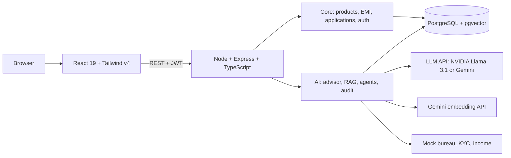
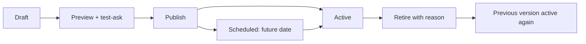

# LoanLens AI — Judges' Deck

> **Judges only.** 11 slides, about 8 minutes, followed by a live demo.
> Each slide has **On screen** content and **Say** notes. Everything is planned design; replace "planned" with real screenshots once it's built.

---

## Slide 1 — Title

**On screen**
- **LoanLens AI**
- Intelligent digital lending and credit advisory for Kestrel Bank
- Team: S1 · S2 · S3
- Stack: React 19 · Node + Express · PostgreSQL + pgvector · Llama 3.1 / Gemini · Gemini embeddings

**Say (S3):** "We built LoanLens AI: an AI loan advisor, a policy assistant that never makes things up, and AI agents that pre-screen applications while a human stays in control."

---

## Slide 2 — The problem

**On screen**

| Customers | Bank staff |
|---|---|
| Don't know which loan or tenure fits | Verify documents by hand |
| Unsure if they're eligible | Apply policy inconsistently |
| Confused by fees and foreclosure rules | Flooded with incomplete applications |
| Upload the same documents again and again | Struggle to explain rejections |
| Can't see application status | Need a complete audit trail for regulators |

**Say (S1):** "Kestrel Bank has 12 million customers. Both sides of the loan desk are slow and inconsistent today."

---

## Slide 3 — Our solution: three AI capabilities

**On screen**
1. **AI Loan Advisor.** Plain English in, products with real EMIs out.
2. **Policy Assistant (RAG).** Answers only from approved bank documents, with sources.
3. **Agentic Pre-screening.** Five specialist agents check an application. A human decides.

Built on a complete lending portal: catalogue, EMI calculator, 4-step application with drafts, uploads, status timeline, and 4 roles (Customer, Loan Officer, Credit Analyst, Policy Admin).

**Say (S3):** "The portal covers everything in Module 1. The three AI features sit on top of it, one per module."

---

## Slide 4 — Architecture

**On screen**

**Say (S1):** "There is one API with two halves. Core banking logic is plain code. The AI layer calls a hosted LLM for language, and Gemini's embedding API to turn text into vectors for search. Postgres stores both the data and the vectors."

---

## Slide 5 — Advisor: AI understands, code calculates

**On screen**

> "I need ₹5 lakh for a used car. I earn ₹60,000 per month and want an EMI below ₹12,000."

| Step | Who | Result |
|---|---|---|
| Extract amount, income, EMI limit | LLM | 500000 · 60000 · 12000 |
| Pick products and tenure | **Code** | VL-204, 48 months gives ₹12,923 (too high), so 60 months gives **₹10,871** |
| Eligibility | **Code** | 18% of income, LIKELY_ELIGIBLE |
| Explain why | LLM | one plain-language sentence |
| Missing info | LLM | one clarifying question |

**Say (S2):** "The AI never does maths. The EMI comes from the standard formula in code, so it's always exact. A unit test asserts ₹10,871."

---

## Slide 6 — Policy assistant: grounded, versioned, safe

**On screen**
- Documents are **split by heading**, **embedded**, and stored with metadata: version, effective date, loan type, audience, segment.
- Every question goes through these steps:
  1. **Mask PII:** PAN, Aadhaar, account numbers.
  2. **Search with filters:** audience, loan type, **version in force only**.
  3. If nothing relevant is found, the answer is **"not found"** and the LLM is never called.
  4. Otherwise the LLM answers only from the found chunks, and **code attaches the sources**.
- Example: *"Can I foreclose my vehicle loan after 6 months?"*
  - Answer: *"Allowed after 6 EMIs, 2% charge."*
  - Source: Vehicle Loan T&C **v2026.3** (older v2025.1 ignored).
- Customers can never see internal officer playbooks.

**Say (S2):** "Three layers stop hallucination: retrieval only, a not-found threshold, and sources added by code rather than written by the AI."

---

## Slide 7 — Policy governance and version control

**On screen**
- **Who:** only the **Policy Admin** (a bank official) can change policies. Every action is audited: `POLICY_DRAFTED` / `POLICY_PUBLISHED` / `POLICY_RETIRED`, with who, when and the change note or reason.
- **How:** every upload is a **new immutable version** under a stable key (`VEHICLE-TNC`).

- **Which version answers?** The PUBLISHED version with the latest effective date ≤ today, computed **at query time**. Future-dated versions go live on their own; no cron job.
- **Example:**
  - v2026.3 active: *"6 EMIs, 2%"*.
  - Admin publishes v2026.4 *"3 EMIs, 1%"*: the same question now cites **v2026.4**.
  - Admin retires v2026.4: the answer cites **v2026.3** again.
- Customers never see drafts, retired, scheduled or internal documents.

**Say (S2):** "A judge asked how the chatbot gets new policies. Only a Policy Admin can change them, and nothing is ever overwritten. A new version is a draft until the admin has previewed it and asked it test questions. Once published, it answers immediately, or on its effective date if that's in the future. If it's wrong, retiring it brings the previous version back on the very next question. Every step is in the audit trail, and every answer already cites its version and date. Next on our roadmap is a second approver, maker-checker."

---

## Slide 8 — Agents: AI recommends, humans decide

**On screen**

| Agent | Checks | Allowed tools |
|---|---|---|
| Document Verification | proofs present, details match | income check |
| Credit Assessment | obligation ratio, score band | credit score, income check |
| Compliance | KYC, policy exceptions | KYC, policy search |
| Customer Communication | plain-language message | none |
| Orchestrator | order, combine, route to human | status update |

Brief's scenario, application LA-2026-00418 (address proof missing):
- Recommendation: **REQUEST_ADDITIONAL_DOCUMENTS**
- Checks: Docs INCOMPLETE · Credit PASS (35%, band 720–760) · Compliance PASS
- `requiresHumanApproval: true` · full audit trail

**Say (S2):** "Each agent can only use its own tools. If one tries something else, it's refused and logged; we'll show that live. The final decision button exists only for the Credit Analyst."

---

## Slide 9 — Guardrails and responsible AI

**On screen**

| Rule | How we enforce it |
|---|---|
| No gender, religion, caste or marital status | These fields don't exist in the database |
| AI never approves or rejects | Only the Credit Analyst role can call the decision API |
| Reason for every recommendation | `reason` / `detail` are required fields |
| Out-of-permission action | Refused and logged as PERMISSION_DENIED |
| Numbers by code, not AI | All maths lives in `loanMath.ts` |
| Only approved documents | RAG plus a not-found threshold; code adds sources |
| PII masked | One `maskPii()` runs on prompts, audit records and logs |
| Human in the loop | A human decides **every** case |
| Only authorised officials change policy | Policy Admin role only; every change versioned and audited |

**Say (S1):** "Every guardrail in the brief is enforced in code, not just in a prompt."

---

## Slide 10 — Why this stack

**On screen**
- The brief **recommends** Spring Boot + Spring AI and **permits** any framework.
- We kept the **same design**: the API contract, Postgres + pgvector, the agents, the audit trail and the guardrails. Only the runtime changed.
- **Node + TypeScript end to end.** This is the team's proven stack, so all three of us review all the code.
- **Zod: one schema** gives request validation, TypeScript types and the LLM's output format, so the brief's JSON can't drift.
- **Swappable LLM.** NVIDIA Llama 3.1 or Gemini, changed with 3 config lines.
- **Gemini embeddings, no local model.** The server stays lightweight, so it deploys on any free or serverless host. It is free with the same Gemini key.
- **Tailwind v4.** Brand tokens live in one CSS block.

| Spring | Ours |
|---|---|
| `@RestController` + `@Valid` | Express + Zod |
| JPA + Flyway | Prisma |
| `ChatClient` / `@Tool` / `BeanOutputConverter` | AI SDK `generateText` / `tool()` / `generateObject` |
| `PgVectorStore` | pgvector SQL |

**Say (S1):** "In a Java bank team we'd use Spring AI. The design ports one-to-one. We chose the stack that let us ship all three modules, tested."

---

## Slide 11 — How we built it, limits, next

**On screen**
- **Process:** contract-first `openapi.yaml` from the brief's JSON. Three parallel streams on three laptops. GitHub PRs every phase. AI-assisted coding with human review. Every requirement ticked only with evidence.
- **Limits, stated honestly:**
  - Credit bureau and KYC are mocks.
  - Login is simulated.
  - The knowledge base has about 10 documents.
  - Masking is regex-based.
  - The LLM depends on a hosted API, with a fallback provider.
  - One Policy Admin can publish alone (no second approver yet).
- **Next:**
  - Real bureau and KYC APIs.
  - OCR on uploaded documents.
  - An evaluation set for RAG accuracy.
  - Bank single sign-on.
  - A turnaround-time dashboard.
  - Maker-checker approval and side-by-side diff for policy versions.

**Say (S3):** "Now let's show you." *(Switch to the live demo: follow `Demo_Runbook.md`.)*

---

## Backup slide — Numbers we can defend

| Claim | Proof |
|---|---|
| EMI ₹5,00,000 @ 11% × 60 = ₹10,871 | `loanMath.test.ts` |
| EMI ₹5,00,000 @ 12% × 48 = ₹13,167; ratio (8,000 + 13,167) / 60,000 = 35% | seed data and `orchestrator.test.ts` |
| Version in force wins (2026.3 over 2025.1); retiring the active version rolls back | `retriever.test.ts` |
| Disallowed tool refused and logged | `permissionGuard.test.ts`, live demo |

## Backup slide — Hard questions

Full answers are in `Judge_QA_Playbook.md`. Short ones are in `Preliminary_Design.md` §13.
