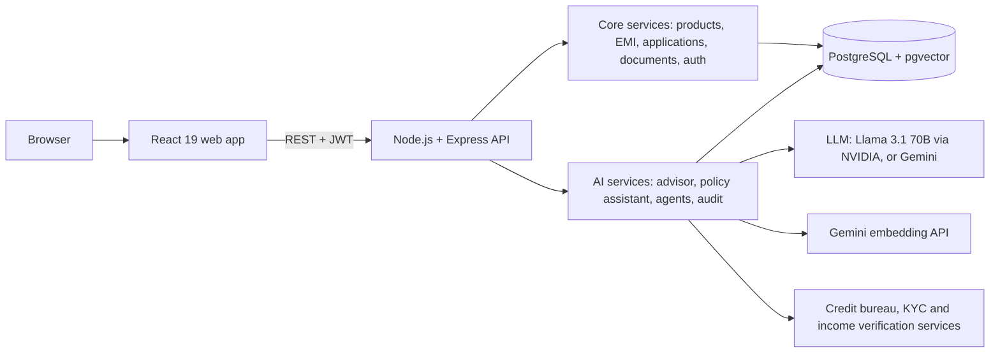
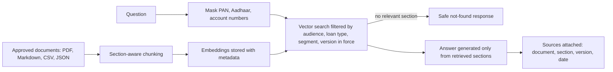
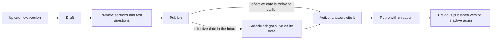
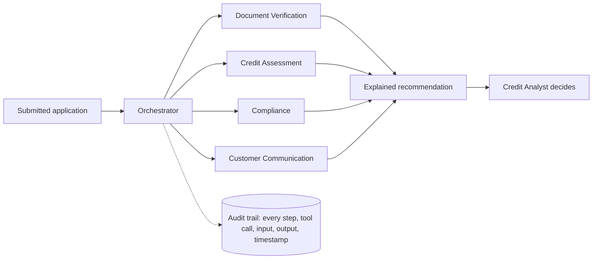
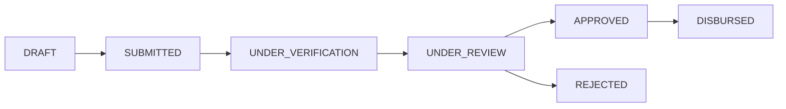

# LoanLens AI

**Intelligent Digital Lending and Credit Advisory Platform for Kestrel Bank**

*Preliminary design overview*

---

## 1. The problem

Kestrel Bank serves over 12 million retail customers across personal, home, vehicle and education loans. The lending process is slow and inconsistent on both sides of the desk.

| Customers face | Lending teams face |
|---|---|
| Difficulty choosing the right product, amount and tenure | Manual document verification and cross-checking |
| Uncertainty about eligibility before applying | Inconsistent application of credit policy |
| Confusion about rates, fees, prepayment and foreclosure | A high volume of incomplete or ineligible applications |
| Repeated requests for the same documents | Difficulty explaining approvals and rejections |
| No visibility of application status | The need for a complete audit trail for regulators |
| Different answers from branch, call centre and app | Coordination across sales, KYC, credit and compliance |

## 2. Our solution

LoanLens AI is a digital lending platform with three AI capabilities built on a complete loan portal.

1. **AI Loan Advisor.** A customer describes their need in plain language. LoanLens recommends suitable products with an accurate EMI and explains why.
2. **Policy Assistant.** It answers loan and policy questions only from the bank's approved documents. Every answer names its source document, section and version.
3. **Agentic Pre-screening.** Specialist AI agents verify documents, assess affordability and check compliance on each application. They produce an explained recommendation for a human credit analyst, who makes the final decision. Every step is recorded in an audit trail.

The surrounding portal provides:
- A product catalogue with search, filtering, sorting and comparison.
- An EMI calculator with a full amortization schedule.
- Customer profiles.
- A multi-step application form with save-as-draft.
- Document upload.
- A status timeline.
- Separate experiences for Customers, Loan Officers, Credit Analysts and Policy Admins.
- A policy console where an authorised bank official drafts, tests, publishes and retires policy versions.

---

## 3. Architecture



A single API serves the web app. **Core services** hold the banking logic: products, EMI calculation, the application lifecycle, document handling and role-based access. **AI services** use a large language model for understanding and writing language, and an embedding model for semantic search. All data, including the vector index for document search, lives in one PostgreSQL database. Credit bureau, KYC and income verification are simulated services behind the same interfaces a real integration would use.

### Technology stack

| Layer | Technology | Purpose |
|---|---|---|
| Frontend | React 19, Vite, TypeScript | Responsive web application |
| Styling | Tailwind CSS v4 | Design system with brand tokens defined in one place |
| Data fetching | TanStack Query | API calls, caching, loading and error states |
| Backend | Node.js 22, Express, TypeScript | REST API |
| Validation | Zod | Validates every request and defines the AI's output format |
| Database | PostgreSQL 16 with pgvector | Relational data and vector search in one store |
| Data access | Prisma | Typed database access and schema migrations |
| AI integration | Vercel AI SDK | Structured output and tool calling, independent of the model provider |
| Language model | Llama 3.1 70B (NVIDIA NIM), Gemini 2.0 Flash | Understands requests, writes explanations and answers |
| Embeddings | Gemini `gemini-embedding-001` | Converts text into vectors for semantic search |
| Authentication | JWT with role-based access | Customer, Loan Officer, Credit Analyst, Policy Admin |
| Infrastructure | Docker Compose | Reproducible database setup |
| Testing | Vitest, Supertest | Unit and API tests |

---

## 4. Module 1 — Loan discovery and the AI Loan Advisor

The advisor separates **understanding** from **calculation**. The language model interprets the request and explains the result. All numbers are computed by code.

**Example request**
> "I need ₹5 lakh for a used car. I earn ₹60,000 per month and want an EMI below ₹12,000."

| Step | Performed by | Outcome |
|---|---|---|
| Interpret the request | Language model | Amount ₹5,00,000 · income ₹60,000 · EMI limit ₹12,000 · purpose: used car |
| Ask for missing information | Language model | One clarifying question if a key detail is absent |
| Select matching products | Code | Pre-owned car loan products within the amount range |
| Find a suitable tenure | Code | 48 months gives an EMI of ₹12,923, which is over the limit. 60 months gives ₹10,871, which fits. |
| Assess likely eligibility | Code | EMI is about 18% of income, so LIKELY_ELIGIBLE |
| Explain the recommendation | Language model | A plain-language reason based on the computed figures |

**Response**
```json
{
  "interpretedRequirement": "Used car loan of 5 lakh with EMI below 12,000",
  "loanAmount": 500000,
  "monthlyIncome": 60000,
  "maxPreferredEmi": 12000,
  "currency": "INR",
  "recommendations": [{
    "productId": "VL-204",
    "productName": "Kestrel Pre-Owned Car Loan",
    "indicativeInterestRate": 11.0,
    "tenureMonths": 60,
    "estimatedEmi": 10871,
    "reason": "60-month tenure keeps EMI within the limit (about 18% of income)",
    "eligibilityIndicator": "LIKELY_ELIGIBLE"
  }],
  "disclaimer": "Indicative only. Final approval is subject to credit assessment.",
  "clarifyingQuestion": null
}
```

EMI uses the standard reducing-balance formula, `EMI = P × r × (1+r)^n / ((1+r)^n − 1)`, where `r` is the monthly rate. It is implemented and unit-tested in code.

---

## 5. Module 2 — Policy Assistant (Retrieval-Augmented Generation)

The assistant answers only from Kestrel Bank's approved documents, never from the model's general knowledge.

**Knowledge base:**
- Loan terms and conditions
- Interest rate and fee schedules
- Credit policy and eligibility criteria
- KYC and document checklists
- Prepayment and foreclosure policy
- Grievance redressal procedure
- Regulatory circular summaries
- Internal loan officer playbooks

Each document carries metadata: version, effective date, loan type, document type, customer segment and audience (customer or internal).



**How answers stay grounded:**
- **Section-aware chunking.** Documents are split at their headings, so each retrieved passage is a complete policy section.
- **Version in force.** When several versions of a policy exist, only the published version currently in force is searched (see section 6).
- **Audience control.** Customers never receive content from internal documents.
- **Relevance threshold.** If no section is relevant enough, the assistant returns a safe "not found" response and the language model is not called.
- **Code-attached sources.** The model reports which passages it used. Code then attaches the title, section, version and effective date, so sources cannot be invented.
- **PII masking.** PAN, Aadhaar and account numbers are masked before any text reaches the model or the logs.

**Example**
```json
{
  "answer": "Foreclosure is allowed after 6 EMIs, with a 2% charge on the outstanding principal.",
  "confidence": "HIGH",
  "sources": [{
    "document": "Vehicle Loan Terms and Conditions",
    "section": "Foreclosure and Part-Prepayment",
    "version": "2026.3",
    "effectiveDate": "2026-07-01"
  }],
  "followUpRequired": false
}
```

---

## 6. Policy governance and version control

Bank policy changes over time. LoanLens gives one authorised bank official, the **Policy Admin**, sole control over what the Policy Assistant can quote, and keeps every version.

- **Versions, not overwrites.** Each upload becomes a new, immutable version under a stable policy key (for example `VEHICLE-TNC`). Earlier versions are kept for history and rollback.
- **Review before go-live.** A new version starts as a draft. The admin previews it exactly as it was split into sections and asks it test questions. Customers and staff never see a draft.
- **Change note and audit.** Every draft, publish and retire records who acted, when, and why (a change note or a retirement reason).



**Which version answers?** For each policy, the assistant uses the published version with the latest effective date that is on or before today. This is worked out each time a question is asked, so a scheduled version goes live on its date with no manual step, and retiring the active version instantly hands over to the previous one. Drafts, retired versions, scheduled versions and internal documents are never shown to customers.

**Example**

| Step | What the customer sees for "Can I foreclose my vehicle loan early?" |
|---|---|
| Vehicle T&C v2026.3 (effective 2026-07-01) is active | "Foreclosure is allowed after 6 EMIs, with a 2% charge." Source: v2026.3 |
| The Policy Admin uploads v2026.4 with the change note "Lock-in 3 EMIs, charge 1%", previews it, test-asks it and publishes it | Same question: "Foreclosure is allowed after 3 EMIs, with a 1% charge." Source: v2026.4 |
| A mistake is found. The admin retires v2026.4 with a reason | Same question: the v2026.3 answer returns, citing v2026.3 |

Every step above appears in the audit trail as `POLICY_DRAFTED`, `POLICY_PUBLISHED` or `POLICY_RETIRED`, with the admin's name, the time and the note.

---

## 7. Module 3 — Agentic loan processing

Five specialist agents pre-process each submitted application. Each agent has a single responsibility and may use only the tools assigned to it.

| Agent | Responsibility | Permitted tools |
|---|---|---|
| Document Verification | Checks that identity, address and income proofs are present. Flags name, income or address mismatches. | Income verification |
| Credit Assessment | Applies policy rules: income-to-obligation ratio and credit score band | Credit bureau score, income verification |
| Compliance | Checks KYC status and policy exceptions against the knowledge base | KYC status, policy search |
| Customer Communication | Drafts plain-language status updates and document requests | None |
| Orchestrator | Routes the application between agents, combines results, decides when a human is required | Application status update |



**Example: personal loan of ₹5 lakh, salary slips and bank statement provided, address proof missing**

```json
{
  "applicationId": "LA-2026-00418",
  "recommendation": "REQUEST_ADDITIONAL_DOCUMENTS",
  "riskBand": "MEDIUM",
  "checks": [
    { "agent": "DocumentVerificationAgent", "result": "INCOMPLETE", "detail": "Address proof is missing" },
    { "agent": "CreditAssessmentAgent", "result": "PASS", "detail": "Obligation ratio is 35% (limit 50%); credit score band is 720-760" },
    { "agent": "ComplianceAgent", "result": "PASS", "detail": "KYC status verified" }
  ],
  "missingDocuments": ["Address proof"],
  "customerMessage": "Please upload a valid address proof to continue your application.",
  "requiresHumanApproval": true,
  "auditTrailId": "AUD-2026-77301"
}
```

**Design principles:**
- **Rules in code, language from the model.** Pass, fail and incomplete outcomes, ratios, risk bands and the final recommendation are decided by deterministic rules. The language model writes the explanations and customer messages.
- **Permission guard.** Every tool call is checked against the agent's permissions. A disallowed call is refused and recorded in the audit trail as `PERMISSION_DENIED`.
- **Human in control.** Agents can only recommend. The approve or reject action is available only to a Credit Analyst, and every recommendation requires human approval.
- **Complete audit trail.** Every agent step, tool call, input, output and timestamp is stored, with sensitive data masked.

---

## 8. Responsible AI and guardrails

| Guardrail | Enforcement |
|---|---|
| Protected attributes are never used in decisions | Gender, religion, caste and marital status are not collected or stored anywhere in the system |
| Agents never approve or reject a loan | Only the Credit Analyst role can call the decision endpoint. Agents have no access to it. |
| Every recommendation has a plain-language reason | `reason` and `detail` are mandatory fields in every response |
| Out-of-permission actions are refused and logged | A permission guard wraps every tool and writes a `PERMISSION_DENIED` audit event |
| Calculations are deterministic | EMI, amortization and income-to-obligation ratio are computed in code, never by the model |
| Answers come only from approved documents | Retrieval with a relevance threshold, a safe not-found response, and sources attached by code |
| Sensitive data is protected | PAN, Aadhaar and account numbers are masked in prompts, audit records and logs |
| Human-in-the-loop review | Every application recommendation is routed to a Credit Analyst |
| Only authorised officials change policy; every change versioned and audited | Only the Policy Admin role can draft, publish or retire a policy. Published versions are never edited, and each action writes a `POLICY_*` audit event with who, when and why. |

---

## 9. Design decisions

**Node.js and TypeScript instead of Spring Boot.** The brief recommends Spring Boot with Spring AI and permits any framework. We kept the recommended architecture: the same API contract, PostgreSQL with pgvector, the agent design, the audit trail and every guardrail. We implemented it in TypeScript. This gives us one language across frontend, backend and AI services. It also gives us one Zod schema that drives request validation, application types and the model's output format, so the brief's response structures cannot drift. Each Spring AI concept has a direct equivalent:

| Spring Boot / Spring AI | LoanLens |
|---|---|
| `@RestController` with `@Valid` | Express router with Zod |
| `@ControllerAdvice` | Central error-handling middleware |
| Spring Security roles | Role-based middleware |
| JPA and Flyway | Prisma models and migrations |
| `ChatClient` | AI SDK `generateText` / `generateObject` |
| `@Tool` | AI SDK `tool()` |
| `BeanOutputConverter` | `generateObject` with a Zod schema |
| `PgVectorStore` | pgvector queries through Prisma |

**Provider-independent language model.** The AI layer talks to the model through an OpenAI-compatible interface. The system runs on Llama 3.1 70B via NVIDIA or on Gemini, and switching is a configuration change.

**Hosted embeddings.** LoanLens is a web application, so search embeddings come from Gemini's embedding API rather than a model hosted on our server. This keeps the backend lightweight and deployable on standard web hosting.

**Contract-first development.** The brief's three response formats were captured in an OpenAPI specification before implementation began. Frontend, core backend and AI services are built against this single contract.

---

## 10. Data model

| Entity | Key contents |
|---|---|
| User | Username, role (Customer, Loan Officer, Credit Analyst, Policy Admin) |
| Customer | Segment (salaried, self-employed, student), employment type, monthly income, existing obligations, location, KYC status |
| Loan product | Product ID, name, loan type, interest rate range, tenure range, amount range, processing fee, eligibility criteria |
| Loan application | Product, amount, tenure, purpose, status, current step |
| Status event | Status, timestamp, actor, note (forms the application timeline) |
| Application document | Type (identity, address, income), file metadata |
| Knowledge document | Policy key (shared by all versions), title, version, effective date, status (draft, published, retired), loan type, document type, audience, segment, change note, created by, published by and at, retired at and reason |
| Knowledge chunk | Section, text, metadata, embedding vector |
| Agent run | Application, recommendation, timing |
| Audit event | Sequence, timestamp, agent, event type, tool, masked input and output |

**Application status flow**


---

## 11. Scope, limitations and roadmap

**In scope:** all three modules of the brief, the four user roles, synthetic customers, products and policy documents, and simulated bureau, KYC and income services.

**Current limitations**
- Credit bureau, KYC and income verification are simulated.
- Authentication uses seeded demonstration accounts.
- The knowledge base contains around ten synthetic documents.
- Sensitive-data masking is pattern-based.
- Document search depends on the Gemini embedding API and its rate limits.
- Uploaded files are stored on the application server.

**Roadmap**
- Integration with real credit bureau and KYC providers.
- OCR-based extraction and cross-checking of uploaded documents.
- An evaluation set measuring retrieval and answer accuracy.
- Enterprise single sign-on.
- Cloud document storage.
- An operations dashboard for turnaround time and application funnel metrics.
- Maker-checker for policy changes: a second official approves a version before it can be published.
- A side-by-side comparison of two policy versions, highlighting what changed.
