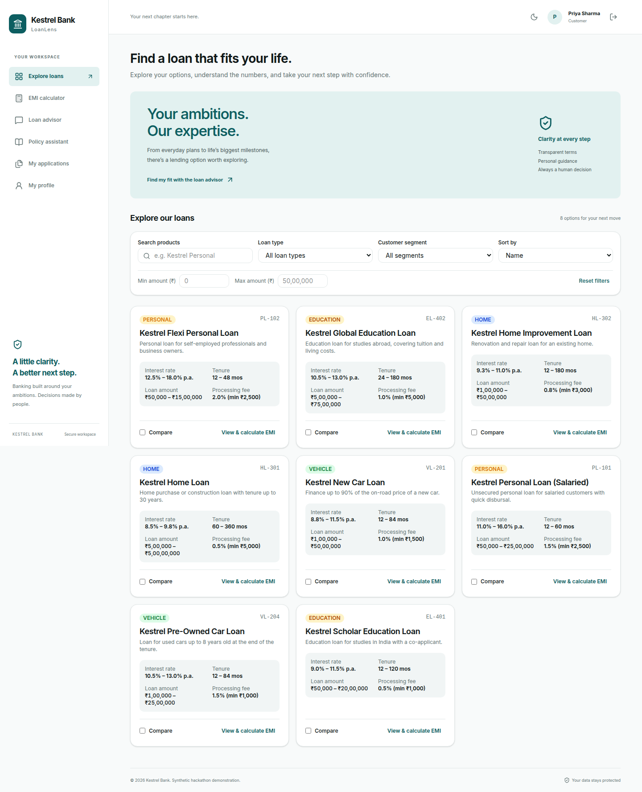
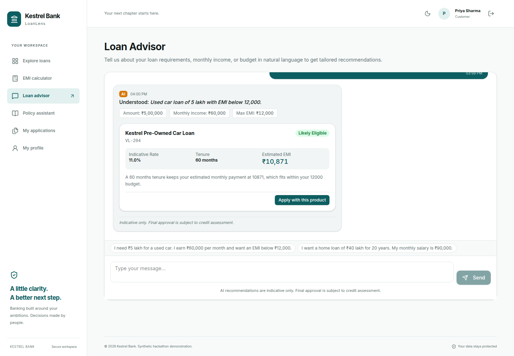
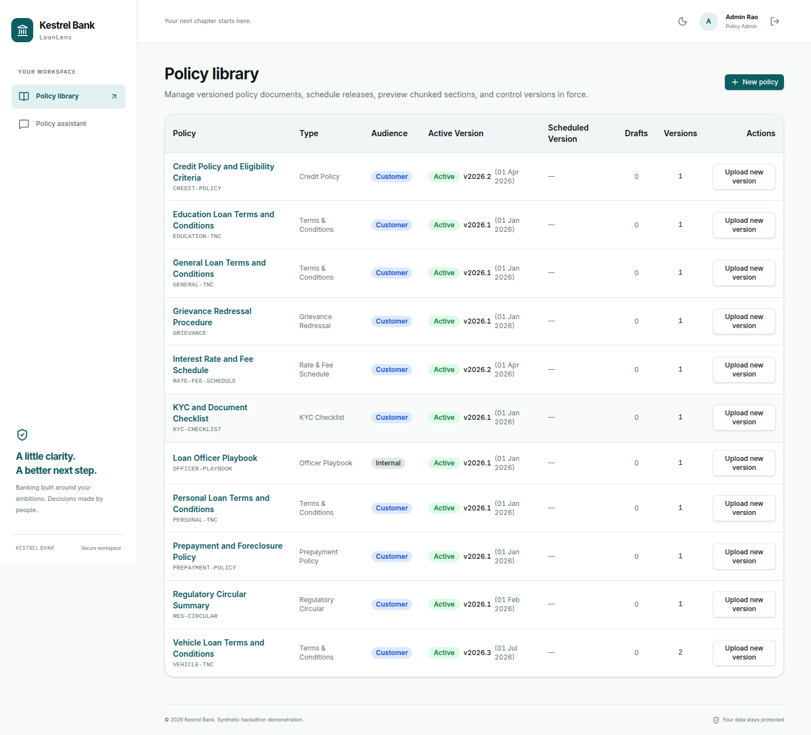
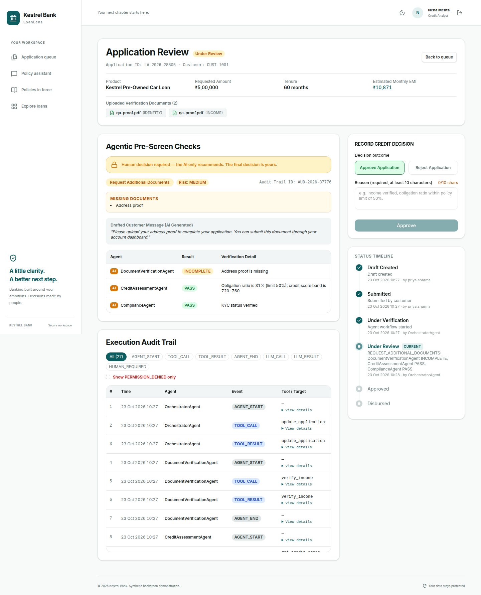
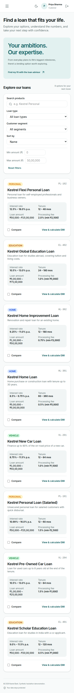
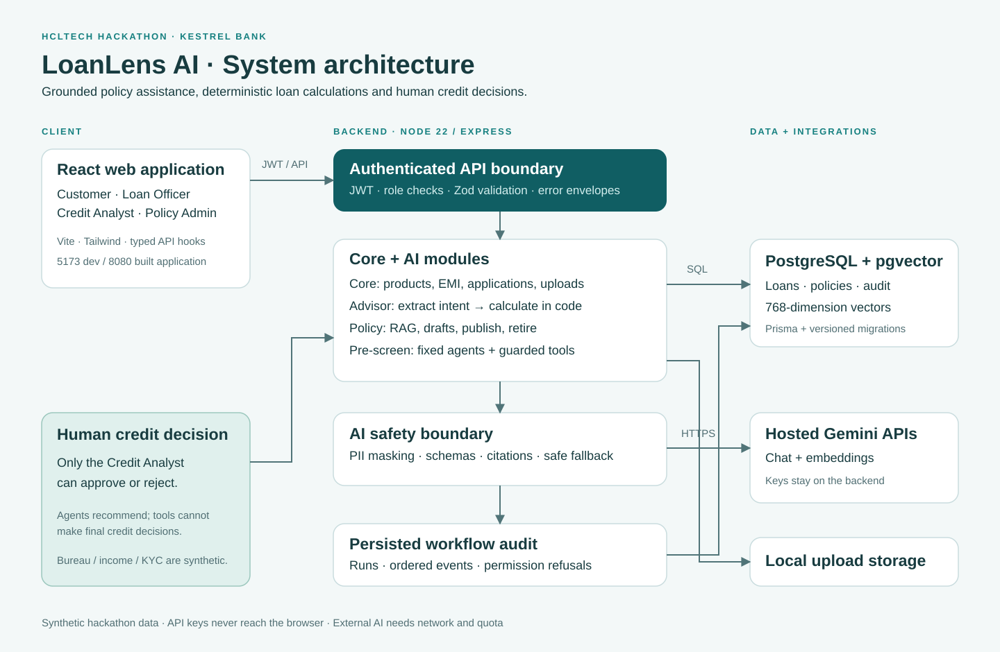

# LoanLens AI · Kestrel Bank

HCLTech hackathon submission: loan discovery and applications, a grounded policy assistant, and auditable loan pre-screening with a human credit analyst making the final decision. All banking data is synthetic.

**Stack:** React 19 · Vite · Tailwind · Node.js 22 · Express · TypeScript · Prisma · PostgreSQL 16 + pgvector · Gemini chat and embeddings.

## Screenshots

### Loan discovery



| AI loan advisor | Policy administration |
|---|---|
|  |  |

| Human analyst review | Mobile catalogue |
|---|---|
|  |  |

Screenshots are recorded local checks; demo data/dates can differ on a new installation. More: [docs/evidence](docs/evidence).

## Architecture



[PNG diagram](docs/architecture.png) · [SVG diagram](docs/architecture.svg) · [architecture](docs/ARCHITECTURE.md) · [solution overview](docs/SOLUTION_OVERVIEW.md)

## Run on your device

Install **Git, Node.js 22 and Docker Desktop/Compose**. Get a Gemini key at [Google AI Studio](https://aistudio.google.com/apikey); hosted AI requires internet and available quota.

```bash
git clone https://github.com/gatik03/Team-J-SONs-.git
cd Team-J-SONs-
```

Open this folder in your editor. Copy `.env.example` to **`.env` in this top-level folder**, beside `docker-compose.yml`. Paste the same Gemini key into **both** `LL_AI_API_KEY` and `LL_EMBED_API_KEY`. Keep the other supplied settings. Never share `.env`.

Terminal 1, from the project folder:

```bash
docker compose up -d --wait
cd backend
npm ci
npm run prisma -- generate
npm run prisma -- migrate deploy
npm run seed
npm run ingest
npm run dev
```

Terminal 2, from the project folder:

```bash
cd frontend
npm ci
npm run dev
```

Open **http://localhost:5173**. [Detailed setup and troubleshooting](docs/SETUP.md).

## Demo logins

Every demo password is **`password`**. Authentication is simulated for the hackathon.

| Role | Username |
|---|---|
| Customer — salaried | `priya.sharma` |
| Customer — self-employed | `rahul.verma` |
| Customer — student | `ananya.iyer` |
| Loan officer | `officer.kumar` |
| Credit analyst | `analyst.mehta` |
| Policy admin | `admin.rao` |

## Submission guide

| Deliverable | Read or run |
|---|---|
| Requirement checklist and verification | [SUBMISSION.md](docs/SUBMISSION.md) |
| Overview and architecture | [SOLUTION_OVERVIEW.md](docs/SOLUTION_OVERVIEW.md), [ARCHITECTURE.md](docs/ARCHITECTURE.md) |
| Schema and migrations | [SCHEMA.md](docs/SCHEMA.md), [schema.prisma](backend/prisma/schema.prisma) |
| Setup | [SETUP.md](docs/SETUP.md), [.env.example](.env.example) |
| Live demonstration | [DEMO.md](docs/DEMO.md) |
| Exact test prompts | [TEST_PROMPTS.md](docs/TEST_PROMPTS.md) |
| AI guardrails and limitations | [GUARDRAILS.md](docs/GUARDRAILS.md) |
| Synthetic seed scripts | [seed.ts](backend/prisma/seed.ts), [knowledge manifest](db/knowledge/manifest.json) |
| API contract | [openapi.yaml](openapi.yaml) |

## Source layout

```text
backend/
  prisma/             # Schema, migrations and synthetic seed
  src/core/           # Auth, customers, products, EMI, applications, uploads
  src/ai/             # Advisor, RAG, governance, agents, tools and audit
  src/common/         # Guards, errors, Prisma and logging
frontend/src/
  api/                # Typed HTTP client and query hooks
  components/         # Reusable and feature-specific UI
  pages/              # Customer, officer, analyst and admin screens
  routes/             # Routing and role guards
db/knowledge/         # Synthetic policies and ingestion manifest
docs/                 # Submission docs, diagrams, screenshots and samples
  archive/            # Historical planning docs; separate supporting ZIP
scripts/              # Reproducible submission packaging
```

## Verification and packaging

From `backend/`, run `npm test` and `npm run build`. From `frontend/`, run `npm test` and `npm run build`. Backend integration tests need the configured PostgreSQL database; automated tests mock provider calls. Recorded live-provider/browser evidence is in `docs/evidence/`.

For a combined local server, build `frontend/`, then run `npm start` from `backend/`. Open **http://localhost:8080**; nested-route reloads are supported.

To recreate the shareable ZIPs, run `python3 scripts/package_submission.py` (Windows: `py scripts/package_submission.py`). The source ZIP includes `.env.example` and excludes credentials, uploads, dependencies, Git history and historical planning docs. Supporting docs are packaged separately. See [SUBMISSION.md](docs/SUBMISSION.md).

This is a local hackathon application. Bureau, income and KYC tools are synthetic; AI outages can still interrupt essential extraction/retrieval. See [GUARDRAILS.md](docs/GUARDRAILS.md).
