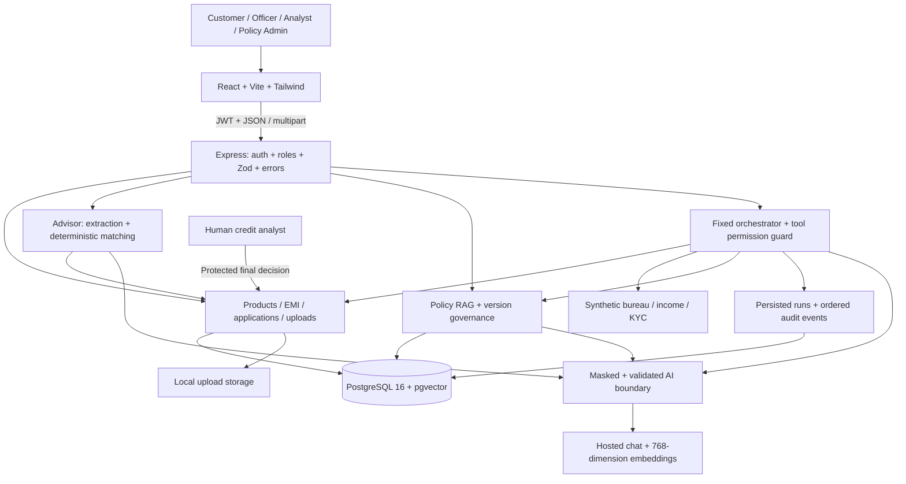

# Architecture

Standalone files: [PNG](architecture.png), [SVG](architecture.svg).

## Implementation boundaries

| Boundary | Implementation |
|---|---|
| Typed UI, query state, routing | `frontend/src/api`, `routes`, `pages` |
| Authentication/errors | `backend/src/common/auth.ts`, `errors.ts` |
| Persistence and loan math | `backend/src/core`, `backend/src/ai/coreBridge.ts` |
| Intent extraction/recommendations | `backend/src/ai/advisor` |
| Parsing, retrieval, governance | `backend/src/ai/rag` |
| Agents/tools/masking/audit | `backend/src/ai/agents`, `tools`, `masking`, `audit` |
| Schema and migration SQL | `backend/prisma/schema.prisma`, `backend/prisma/migrations` |

Development uses Vite on 5173 with an `/api` proxy to Express on 8080. Express can serve the built frontend directly on 8080. Docker Compose runs PostgreSQL/pgvector. Hosted AI is called only by the backend; keys never enter the browser bundle.

## Data paths

- **Advisor:** masked text → validated extraction → real customer/product services → deterministic EMI/tenure/eligibility → bounded optional explanation or template.
- **Policy:** masked question → embedding → in-force/audience-filtered retrieval → cited generation → numeric grounding → answer or safe fallback.
- **Review:** staff request → persisted run → permission-checked tools → audit events → recommendation → human credit decision. Customers receive a safe next-step projection.
- **Governance:** admin upload → validated file/metadata → embedded DRAFT → preview/test → publish/schedule → serving; retirement exposes the previous eligible version.

See [physical schema and constraints](SCHEMA.md) and [responsible-AI limitations](GUARDRAILS.md).
