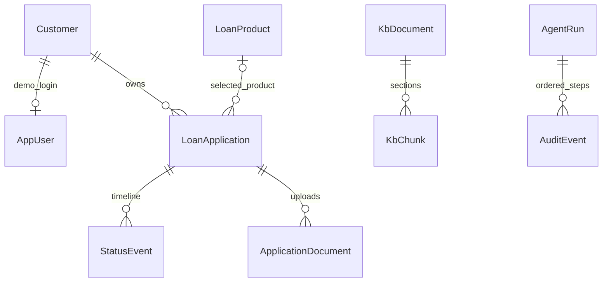

# Schema design

Source of truth: [Prisma schema](../backend/prisma/schema.prisma), [SQL migrations](../backend/prisma/migrations). Migration SQL also creates pgvector and its vector index.

| Area | Constraints and rationale |
|---|---|
| Users | Username primary key, enum role, optional unique customer foreign key; nullable salted password hash for registered customers. Seeded accounts retain simulated login. Registration creates user/profile atomically with customer-only role and pending KYC. |
| Applications | Customer/product foreign keys, nullable draft fields, enum status, customer/status indexes. Amounts/EMIs use integer rupees; indicative rates use floating point. |
| Timeline/uploads | Application foreign keys with cascade delete; file metadata separated from local bytes. Seed document rows support mock verification. |
| Policy versions | Unique `(documentKey, version)`; index `(documentKey, status, effectiveDate)`; publication/retirement actor/time; no mutable latest flag. |
| Chunks | Policy foreign key, section, ordinal, content and normalized `vector(768)` queried with cosine distance. |
| Audits | Run primary trail ID; events have unique `(auditTrailId, sequence)` and run foreign key. Masked JSON input/output. |
| Flexible payloads | Eligibility, recommendations and audit payloads use JSON; service/schema boundaries constrain their shape. |
| Cross-module IDs | `AgentRun.applicationId` is a string rather than a foreign key because it supports both application IDs and policy-key audit trails. Consistency is a service responsibility. |
| Protected fields | No gender, religion, caste or marital-status columns in customer/application decision models. |

Transitions compare current status inside a transaction. Admin APIs preserve version content and enforce lifecycle transitions. Audit append-only behavior is a service rule, not database-enforced tamper-proof storage. See [limitations](GUARDRAILS.md).
